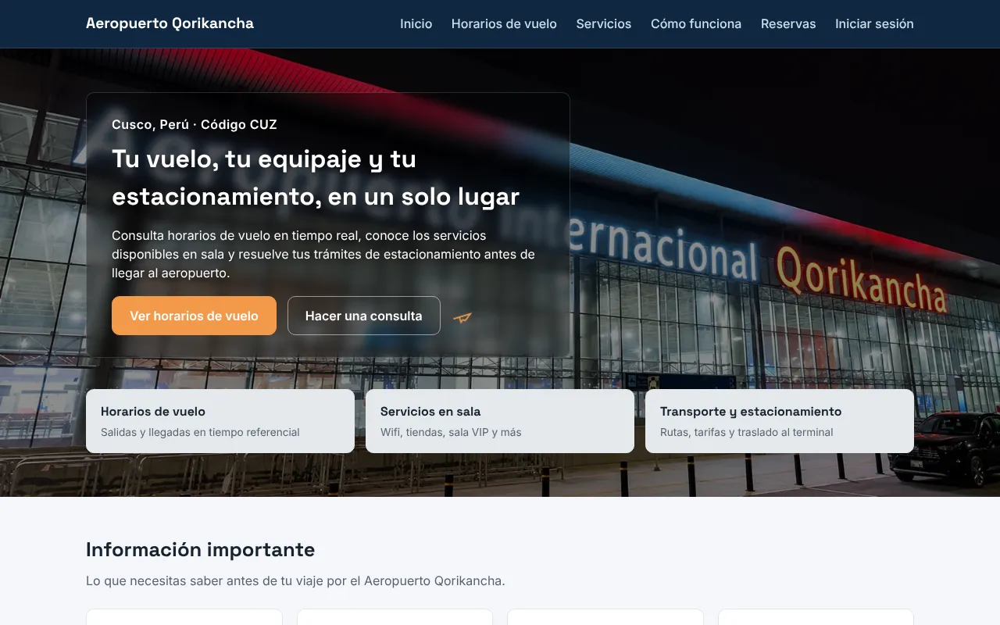
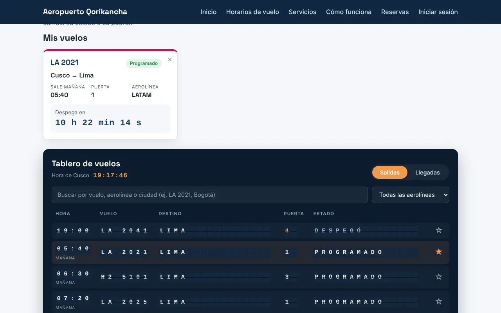
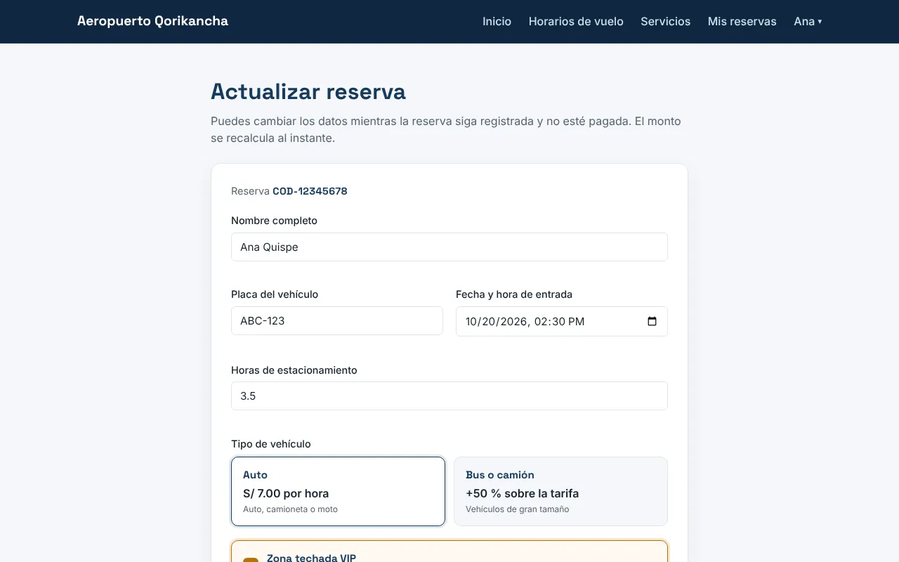

# ✈️ Aeropuerto Internacional Qorikancha — Cusco

Sitio web del **Aeropuerto Internacional Qorikancha** (código CUZ): horarios de vuelo, servicios en sala, transporte y un **sistema de estacionamiento** completo, con reservas, pago en línea, caja presencial y panel de administración.

> Caso académico ficticio. Los datos de vuelos, tarjetas y billeteras son de prueba.



## Funcionalidades

### Para el público
- **Inicio** con información del aeropuerto, servicios y requisitos.
- **Tablero de vuelos en vivo** estilo aeropuerto, con letras que giran, pestañas de salidas y llegadas, y estados que cambian con la hora de Cusco (programado, a tiempo, embarcando, puerta cerrada, demorado, cancelado).
- **Buscador de vuelos** por número, aerolínea o ciudad, y filtro por aerolínea.
- **Seguir mi vuelo**: con la estrella ☆ el vuelo pasa a "Mis vuelos", con cuenta regresiva y avisos si cambia su estado, su hora o su puerta. Se guarda en el navegador.
- **Aerolíneas**: mostrador, teléfono, destinos y próximo vuelo de cada una.
- **Servicios**: tiendas y restaurantes, objetos perdidos, taxis, buses y alquiler de autos.

### Cliente
- **Reservar estacionamiento** con cotización en vivo: S/ 7.00 por hora o fracción, +50 % para bus o camión y +S/ 15.00 por zona techada VIP.
- **Mis reservas**: lista con el estado de pago y botones para pagar, editar o ver el comprobante.
- **Editar reserva** mientras esté registrada y sin pagar; el monto se recalcula.
- **Pasarela de pago** con tarjeta (Visa, Mastercard, American Express) o billetera (AndiPay, PagoMóvil).
- **Comprobante** imprimible que habilita el pase de salida.

### Cajero
- **Cobro presencial** en efectivo (con cálculo de vuelto), POS o billetera.
- **Control de salida (garita)** por placa o código.
- **Conciliación** de los pagos recibidos por la pasarela.
- **Cierre de caja** con resumen del día, que se actualiza cada 15 segundos.

### Administrador y empleado
- **Panel** con indicadores, búsqueda y filtros de reservas.
- Crear, editar, atender y cancelar reservas.
- **Gestión de empleados** con horarios de turno (diurno o nocturno, hora de Perú).
- **Auditoría**: quién gestionó cada reserva y cuándo.





## Tecnologías

| Capa | Tecnología |
|---|---|
| Interfaz | HTML5, CSS3 y JavaScript (módulos ES), sin frameworks |
| Base de datos | [Neon](https://neon.tech) (PostgreSQL serverless) |
| Conexión | `@neondatabase/serverless`, cargado desde CDN (esm.sh) |
| Tipografías | Space Grotesk e Inter (Google Fonts) |

## Estructura del proyecto

```
├── index.html               Inicio
├── vuelos.html              Tablero de vuelos en vivo
├── aerolineas.html          Aerolíneas
├── Servicios.html, Objetos.html, tienda_restaurante.html
├── taxis.html, buses.html, alquiler.html
├── login.html               Iniciar sesión / crear cuenta
├── Transporte.html          Reservar estacionamiento (cliente)
├── mis-reservas.html        Mis reservas (cliente)
├── actualizar.html          Editar reserva (cliente)
├── pago.html                Pasarela de pago (cliente)
├── comprobante.html         Constancia de pago
├── caja.html                Módulo de caja (cajero)
├── panel.html               Panel de gestión (administrador y empleado)
├── 404.html                 Página no encontrada
├── css/
│   ├── base.css             Estilos comunes: colores, encabezado, menú y pie de página
│   └── <página>.css         Estilos propios de cada página
├── js/
│   ├── config/              Conexión a Neon y utilidades de interfaz
│   ├── auth/                Login, sesión y roles
│   ├── registro/            Reserva y reglas de tarifa (tarifario.js)
│   ├── consulta/            Mis reservas
│   ├── actualizar/          Editar reserva
│   ├── pago/                Validaciones y pasarela
│   ├── comprobante/         Constancia de pago
│   ├── caja/                Módulo de caja
│   ├── panel/               Panel de gestión
│   └── vuelos/              Vuelos simulados, tablero y aerolíneas
├── imagenes/
└── docs/capturas/
```

## Cómo ejecutarlo

El proyecto usa módulos de JavaScript, así que **debe abrirse con un servidor**: al abrir el archivo con doble clic, los módulos no cargan.

**Opción 1: VS Code.** Instala la extensión **Live Server**, haz clic derecho en `index.html` y elige *Open with Live Server*.

**Opción 2: terminal.**
```bash
python -m http.server 8000
# abre http://localhost:8000
```

**Opción 3: GitHub Pages.** En *Settings → Pages*, elige la rama `main` y la carpeta `/ (root)`.

### Configurar la base de datos
La cadena de conexión está en `js/config/neon-config.js`. Para usar tu propia base, cópiala desde el panel de Neon (*Connect → Connection string*).

## Roles

| Rol | Página de inicio | Cómo se obtiene |
|---|---|---|
| `cliente` | Reservar estacionamiento | Creando una cuenta en `login.html` |
| `cajero` | Caja | Asignado en la tabla `usuarios` |
| `empleado` | Panel (solo dentro de su turno) | Creado por el administrador desde el panel |
| `administrador` | Panel (con acceso a caja) | Asignado en la tabla `usuarios` |

## Vuelos simulados

Los vuelos no se guardan en la base de datos. Están en `js/vuelos/datos-vuelos.js` como un itinerario diario, y su estado se calcula con la hora de Cusco. Las demoras, cancelaciones y cambios de puerta se eligen al azar, pero son siempre los mismos para un mismo día, así el tablero se ve en vivo a cualquier hora. Para agregar o cambiar un vuelo, se edita el arreglo `ITINERARIO`.

Enlaces directos: `vuelos.html?aerolinea=LA`, `vuelos.html?vuelo=LA2021` y `vuelos.html?tipo=llegada`.

## Datos de prueba para pagos

La página de pago tiene botones que llenan el formulario automáticamente.

| Caso | Número / celular | Venc. | CVV / código |
|---|---|---|---|
| Visa débito (aprobada) | 4111 1111 1111 1111 | 12/29 | 123 |
| Mastercard crédito (aprobada) | 5555 5555 5555 4444 | 05/30 | 789 |
| American Express (aprobada) | 3782 822463 10005 | 11/28 | 1234 |
| Visa (saldo insuficiente) | 4000 0000 0000 0002 | 08/28 | 456 |
| Mastercard (bloqueada) | 5105 1051 0510 5100 | 03/27 | 321 |
| AndiPay (aprobada) | 987 654 321 | — | 123456 |
| PagoMóvil (saldo insuficiente) | 912 345 678 | — | 654321 |

## Tablas principales

| Tabla | Para qué sirve |
|---|---|
| `usuarios` | Cuentas, rol, estado activo y horario de turno |
| `reservas_estacionamiento` | Reservas: placa, horas, vehículo, zona VIP, monto, estado y estado de pago |
| `pagos` | Cada intento de pago (aprobado o rechazado), canal, medio, cajero y verificación |
| `banco_cuentas`, `banco_tarjetas` | Entidad emisora simulada para la pasarela |
| `billeteras` | Billeteras electrónicas simuladas |

## Seguridad: notas del caso académico

- La conexión a la base de datos se hace desde el navegador, por eso la cadena de conexión es visible. En un sistema real, las consultas pasarían por un servidor (API) y la cadena estaría en variables de entorno.
- Las consultas usan plantillas con parámetros del driver de Neon, lo que evita la inyección SQL.
- Los datos se muestran con `textContent` o escapados, lo que evita la inyección de HTML (XSS).
- Los montos siempre se recalculan o se leen de la base de datos; nunca se confía en el valor del formulario.
- Los pagos se confirman en **transacciones**: se descuenta el saldo, se registra el pago y se marca la reserva, o no se hace nada.
